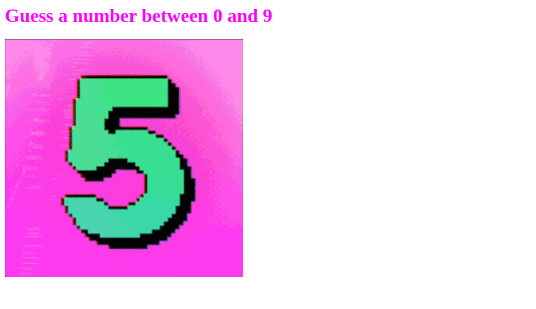
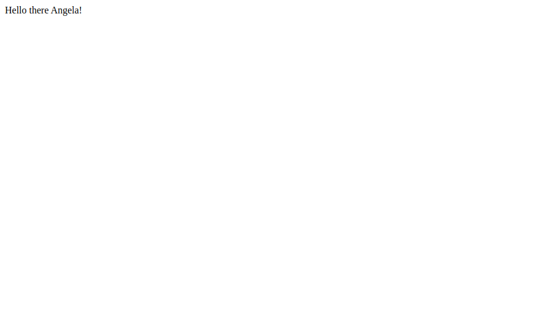
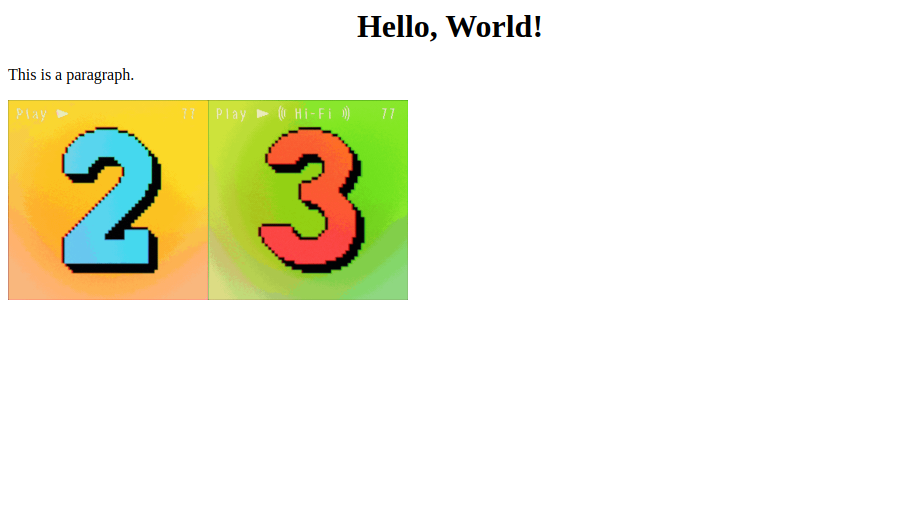
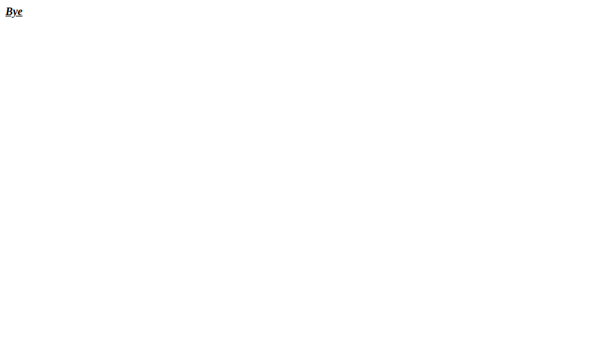
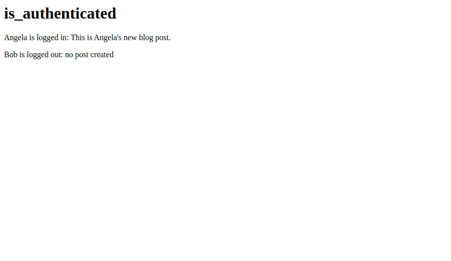
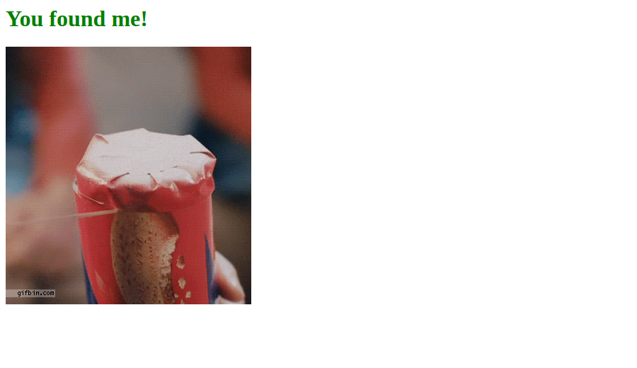

# 🚀 Higher or Lower

Day 55 of Udemy's *100 Days of Code: The Complete Python Pro Bootcamp*: a Higher or Lower guessing game as a Flask website, written for fellow course participants and for anyone who browses the repository for ideas.

## 📚 Table of Contents

- [Overview](#-overview)
- [Requirements](#-requirements)
- [Setup](#-setup)
- [Run](#-run)
- [Tests](#-tests)
- [License](#-license)
- [Links](#-links)
- [Appendix: Project documents](#-appendix-project-documents)

## 🧭 Overview

The site picks a secret number between 0 and 9. Open `/` for the start page, then guess by putting a number in the URL, for example `/3`. The page tells you whether the guess is too low, too high or correct, with a different heading colour and GIF for each answer.

The repository also holds the small Flask programs of the day's lectures: URL paths, rendering HTML and decorators.

| Part | What it is for |
| --- | --- |
| `server.py` | Starts the game, as the assignment asks |
| `src/higher_lower/` | The game, split in layers: `domain`, `application`, `infrastructure`, `presentation` |
| `src/higher_lower/constants.py` | Every heading, colour, GIF and number range in one place |
| `tests/` | pytest tests |
| `tools/` | Script that captures the lecture screenshots in a Docker container |
| `docs/` | Project documents (business case, plan, milestones, reviews) |
| `Doxyfile` | Settings to generate API documentation with Doxygen |

### Lecture steps

One screenshot for each lecture step. The [wiki][wiki] explains what each step teaches, in English, Danish and Bahasa Malaysia.

| Step | Code | Screenshot |
| --- | --- | --- |
| 1. Goals: what you build | `server.py` |  |
| 2. URL paths and variable routes | `step_02_url_paths.py` |  |
| 3. Rendering HTML | `step_03_html.py` |  |
| 4. Decorators for HTML tags | `step_04_decorators.py` |  |
| 5. Advanced decorators with `*args` and `**kwargs` | `step_05_authenticated.py` |  |
| 6. Final project: 3 is too low | `server.py` |  |
| 6. Final project: 7 is too high | `server.py` |  |
| 6. Final project: 5 is correct | `server.py` |  |

The lecture modules are in `src/higher_lower/presentation/lectures/`; run one with `python -m higher_lower.presentation.lectures.step_02_url_paths`. The screenshots were taken in a Docker container with a headless browser (`bash tools/capture_screenshots.sh`), not on a desktop.

## 📋 Requirements

- Python 3.13 or later, to run the code.
- Flask, the only runtime dependency, installed by the setup below.
- pytest, to run the tests (installed with the `test` extra).
- Doxygen, only if you want to generate the API documentation.

## 🛠️ Setup

Create a local virtual environment named `.venv` in the project folder, activate it, upgrade pip and install the project.

Windows (PowerShell):

```powershell
python -m venv .venv
.\.venv\Scripts\Activate.ps1
python -m pip install --upgrade pip
python -m pip install -e ".[test]"
```

Linux and macOS:

```bash
python3 -m venv .venv
source .venv/bin/activate
python -m pip install --upgrade pip
python -m pip install -e ".[test]"
```

While the environment is active, the prompt starts with `(.venv)`. Leave it with `deactivate`. Delete the `.venv` folder to start over.

## ▶️ Run

```bash
python server.py
```

Open `http://127.0.0.1:5000/` in a browser, then try `http://127.0.0.1:5000/3`.

## 🧪 Tests

```bash
python -m pytest
```

Generate the API documentation with Doxygen into `build/html`:

```bash
doxygen Doxyfile
```

## 📄 License

GNU Affero General Public License v3.0, see [LICENSE][license].

## 🔗 Links

- [Repository][repository]
- [Documentation][documentation]
- [Issue tracker][issues]

## 📎 Appendix: Project documents

The documents a newcomer needs, in reading order.

| Document | What it tells you |
| --- | --- |
| [AGENTS.md][agents] | The rules AI agents follow in this repository |
| [Business Case][BC-001] | Why the project exists, its scope and success criteria |
| [Stakeholder Analysis][SA-001] | Who is involved; the stakeholder IDs used for owners and reviewers |
| [Project Plan][PP-001] | The gateways and their schedule |
| [Milestones][milestones] | One document per gateway: Go/No-Go criteria and tasks |
| [Artifact registry][registry] | Where each artifact type lives, the next version, the PO language and domain |
| [Framework README][framework-readme] | The framework this project uses |
| [Framework changelog][framework-changelog] | What changed in each framework release |

---

[license]: ./LICENSE
[repository]: https://git.tirsystem.com/Tirsvad-Udemy-100-days-of-code/055-higher-lower
[documentation]: ./docs/
[issues]: https://git.tirsystem.com/Tirsvad-Udemy-100-days-of-code/055-higher-lower/issues
[wiki]: https://git.tirsystem.com/Tirsvad-Udemy-100-days-of-code/055-higher-lower/wiki
[agents]: ./AGENTS.md
[BC-001]: ./docs/business-case.md
[SA-001]: ./docs/stakeholder-analysis.md
[PP-001]: ./docs/project-plan.md
[milestones]: ./docs/milestones/
[registry]: ./docs/artifact-registry.md
[framework-readme]: ./framework/README.md
[framework-changelog]: ./framework/CHANGELOG.md
