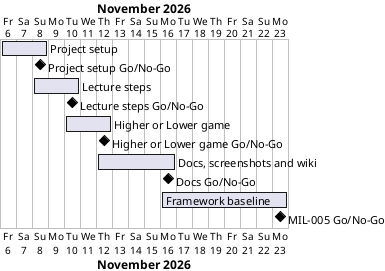

# Project Plan

## Metadata
| Key | Value |
| --- | --- |
| ID | PP-001 |
| CrossReference | [BC-001], [SA-001], [MIL-001], [MIL-002], [MIL-003], [MIL-004], [MIL-005] |
| Language | en |
| Domain | education |

## Version History
| Date | Status | Author | Reviewer | Change | Commit |
| --- | --- | --- | --- | --- | --- |
| 2026-11-06 | Deprecated | Jens Tirsvad Nielsen | AI as stand-in for S01 | Initial version | [42b3a09] |
| 2026-11-16 | Accepted | Jens Tirsvad Nielsen | AI as stand-in for S01 | Added the baseline gateway MIL-005 with its schedule row, scope coverage, dependency, risk and Gantt entries; recorded the move of the end date, the domain and the open pull request #28 in the Planning Assumptions and Open Issues; set the domain to education; reviewed in autonomous mode, not independent | [37e0eab] |

---
## Purpose

This plan schedules the four phases (and, since the baseline gateway [MIL-005], a fifth) that deliver the Higher or Lower Flask project within the few-day effort stated in [BC-001]. S01 is the Product Owner and owns every phase; [SA-001] sets the cadence: one reviewed pull request per phase.

## Planning Assumptions

- Week 1 starts 2026-11-06; the plan ends by 2026-11-16, the few-day effort of [BC-001] Constraints; the dates are the planner's estimate, accepted by S01 in chat on 2026-11-06.
- The baseline gateway MIL-005 starts 2026-11-16 and ends 2026-11-23, one week (source: [BC-001], Constraints). It brings the finished project to the baseline of the framework, a decision of S01. The decision dates of the earlier gateways stay as they were, so the end date of the plan moves from 2026-11-16 to 2026-11-23.
- For MIL-005 S01 has authorised the assistant to commit, push, open the pull request and merge it, and the review is done by an AI stand-in for S01 (source: [BC-001], Constraints and Risks).
- Phase length: two to three days each; one branch and one pull request per phase.
- Autonomous mode: the AI acts as stand-in reviewer for S01 and every review record says so.
- Tokens come from `.env`, which is ignored by git and never imported by the project.

## Gateway Schedule

| Gateway | Document | Window | Decision date | Owner | Stories | Main deliverable | Milestone |
| --- | --- | --- | --- | --- | --- | --- | --- |
| Project setup | [MIL-001] | 2026-11-06 to 2026-11-08 | 2026-11-08 | S01 | none (technical tasks) | Skeleton, tooling, README, repository metadata | [MS-001] |
| Lecture steps | [MIL-002] | 2026-11-08 to 2026-11-10 | 2026-11-10 | S01 | none (technical tasks) | Routes, HTML and decorator modules with tests | [MS-002] |
| Higher or Lower game | [MIL-003] | 2026-11-10 to 2026-11-12 | 2026-11-12 | S01 | none (technical tasks) | The final project with tests | [MS-003] |
| Docs, screenshots and wiki | [MIL-004] | 2026-11-12 to 2026-11-16 | 2026-11-16 | S01 | none (technical tasks) | Screenshots, README, wiki in en, da, ms | [MS-004] |
| Framework baseline | [MIL-005] | 2026-11-16 to 2026-11-23 | 2026-11-23 | S01 | none (technical tasks) | Branch `mil-005-framework-baseline` merged: the adopted framework release, the README, licence and project URL metadata, `.editorconfig`, `.env.example`, the traceability matrix, review records and the indentation of the screenshot shell script | [MS-005] |



## Scope Coverage

| Business Case scope item | Gateway |
| --- | --- |
| Flask application in `src/`, tests in `tests/` | MIL-002, MIL-003 |
| `constants.py`, `pyproject.toml`, `.gitignore`, Doxygen comments, `Doxyfile` | MIL-001 |
| README from the framework template | MIL-001, MIL-004 |
| Screenshots and wiki in en, da, ms | MIL-004 |
| Repository description and topics | MIL-001 |
| The baseline: framework release, README, licence and project URL metadata, editor settings, environment template, traceability matrix, review records, shell indentation (objective 8) | MIL-005 |

## Dependencies

```
MIL-001 → MIL-002 → MIL-003 → MIL-004 → MIL-005
```

A No-Go on a phase stops the later phases; their dates and the end date move by the length of the rework, and S01 decides the move.

## Plan Risks

| Risk | Impact | Mitigation |
| --- | --- | --- |
| Docker Desktop is not running on the host, so screenshots cannot be taken in a container (BC-001 risk: screenshots need a browser) | MIL-004 blocked | Start Docker Desktop, or use Windows Sandbox; stop and report if neither is available |
| The three-language wiki takes longer than planned (BC-001 risk: translation errors in da or ms) | MIL-004 slips | Keep pages short and structurally identical |
| A continuous integration (CI) check fails on the pull request of MIL-005 | The merge is delayed past 2026-11-23 | The failure is fixed on the same branch and the checks run again; after three failed rounds on one cause the work stops and S01 decides (trace: success criterion 7 of [BC-001]) |

## Open Issues

- The user named `https://git.tirsystem.com/Tirsvad-Udemy-100_days_of_code`; `origin` points at `Tirsvad-Udemy-100-days-of-code/055-higher-lower`. The plan uses `origin`; S01 can correct this at plan acceptance.
- The tasks are plain technical tasks with no use case, because the assignment text is the specification; a use case is added if the reviewer asks for one.
- The wiki is written as flat files in `docs/wiki/` (English `Page.md`, Danish `Page-da.md`, Bahasa Malaysia `Page-ms.md`), as `framework/process/wiki.md` requires; the framework workflow publishes it to the host wiki after merge.
- Domain: since [MIL-005] the plan, the Business Case and the baseline milestone have the domain `education`. The other documents (Stakeholder Analysis, milestones MIL-001 to MIL-004 and the review records RC-001 to RC-013) keep the domain `it` they were accepted with; they are not changed by the baseline, and a change of their domain would need a new review of each. The project has no Domain Dictionary and no Architecture Decision Record.
- The git host also has the open pull request #28 (framework submodule URL in lowercase); the baseline delivers the same change in the pull request of MIL-005, and S01 closes #28 after the merge.
- The milestones MIL-001 to MIL-004 are linked on the git host as MS-001 to MS-004; the milestone of MIL-005 is linked after the sync as MS-005.
- `.editorconfig` of the framework baseline sets the shell indentation to 2 spaces, and `tools/capture_screenshots.sh` used tabs (as `shfmt` writes them without an editor configuration), so the shell format check of the shared workflow would fail; MIL-005 re-indents that one file (task 6), without a suppression and without changing a command.

---

[BC-001]: ./business-case.md
[SA-001]: ./stakeholder-analysis.md
[MIL-001]: ./milestones/mil-001-project-setup.md
[MIL-002]: ./milestones/mil-002-lecture-steps.md
[MIL-003]: ./milestones/mil-003-higher-lower-game.md
[MIL-004]: ./milestones/mil-004-docs-screenshots-wiki.md
[42b3a09]: https://git.tirsystem.com/Tirsvad-Udemy-100-days-of-code/055-higher-lower/commit/42b3a093b773c9743ae3c104e1c30bf3dc480d7c
[MS-001]: https://git.tirsystem.com/Tirsvad-Udemy-100-days-of-code/055-higher-lower/milestone/347
[MS-002]: https://git.tirsystem.com/Tirsvad-Udemy-100-days-of-code/055-higher-lower/milestone/348
[MS-003]: https://git.tirsystem.com/Tirsvad-Udemy-100-days-of-code/055-higher-lower/milestone/349
[MS-004]: https://git.tirsystem.com/Tirsvad-Udemy-100-days-of-code/055-higher-lower/milestone/350
[MIL-005]: ./milestones/mil-005-framework-baseline.md
[MS-005]: https://git.tirsystem.com/Tirsvad-Udemy-100-days-of-code/055-higher-lower/milestone/575
[37e0eab]: https://git.tirsystem.com/Tirsvad-Udemy-100-days-of-code/055-higher-lower/commit/37e0eab8e402f60b832a5194cf14347a63119736
