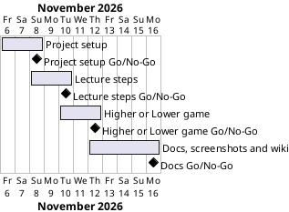

# Project Plan

## Metadata
| Key | Value |
| --- | --- |
| ID | PP-001 |
| CrossReference | [BC-001], [SA-001] |
| Language | en |
| Domain | it |

## Version History
| Date | Status | Author | Reviewer | Change | Commit |
| --- | --- | --- | --- | --- | --- |
| 2026-11-06 | Accepted | Jens Tirsvad Nielsen | AI as stand-in for S01 | Initial version | [42b3a09] |

---
## Purpose

This plan schedules the four phases that deliver the Higher or Lower Flask project within the few-day effort stated in [BC-001]. S01 is the Product Owner and owns every phase; [SA-001] sets the cadence: one reviewed pull request per phase.

## Planning Assumptions

- Week 1 starts 2026-11-06; the plan ends by 2026-11-16, the few-day effort of [BC-001] Constraints; the dates are the planner's estimate, accepted by S01 in chat on 2026-11-06.
- Phase length: two to three days each; one branch and one pull request per phase.
- Autonomous mode: the AI acts as stand-in reviewer for S01 and every review record says so.
- Tokens come from `.env`, which is ignored by git and never imported by the project.

## Gateway Schedule

| Gateway | Document | Window | Decision date | Owner | Stories | Main deliverable | Milestone |
| --- | --- | --- | --- | --- | --- | --- | --- |
| Project setup | [MIL-001] | 2026-11-06 to 2026-11-08 | 2026-11-08 | S01 | none (technical tasks) | Skeleton, tooling, README, repository metadata | [MS-001] |
| Lecture steps | [MIL-002] | 2026-11-08 to 2026-11-10 | 2026-11-10 | S01 | none (technical tasks) | Routes, HTML and decorator modules with tests | [MS-002] |
| Higher or Lower game | [MIL-003] | 2026-11-10 to 2026-11-12 | 2026-11-12 | S01 | none (technical tasks) | The final project with tests | [MS-003] |
| Docs, screenshots and wiki | [MIL-004] | 2026-11-12 to 2026-11-16 | 2026-11-16 | S01 | none (technical tasks) | Screenshots, README, wiki in en, da, ms | [MS-004] |



## Scope Coverage

| Business Case scope item | Gateway |
| --- | --- |
| Flask application in `src/`, tests in `tests/` | MIL-002, MIL-003 |
| `constants.py`, `pyproject.toml`, `.gitignore`, Doxygen comments, `Doxyfile` | MIL-001 |
| README from the framework template | MIL-001, MIL-004 |
| Screenshots and wiki in en, da, ms | MIL-004 |
| Repository description and topics | MIL-001 |

## Dependencies

```
MIL-001 → MIL-002 → MIL-003 → MIL-004
```

A No-Go on a phase stops the later phases; their dates and the end date move by the length of the rework, and S01 decides the move.

## Plan Risks

| Risk | Impact | Mitigation |
| --- | --- | --- |
| Docker Desktop is not running on the host, so screenshots cannot be taken in a container (BC-001 risk: screenshots need a browser) | MIL-004 blocked | Start Docker Desktop, or use Windows Sandbox; stop and report if neither is available |
| The three-language wiki takes longer than planned (BC-001 risk: translation errors in da or ms) | MIL-004 slips | Keep pages short and structurally identical |

## Open Issues

- The user named `https://git.tirsystem.com/Tirsvad-Udemy-100_days_of_code`; `origin` points at `Tirsvad-Udemy-100-days-of-code/055-higher-lower`. The plan uses `origin`; S01 can correct this at plan acceptance.
- The tasks are plain technical tasks with no use case, because the assignment text is the specification; a use case is added if the reviewer asks for one.
- The wiki is written as flat files in `docs/wiki/` (English `Page.md`, Danish `Page-da.md`, Bahasa Malaysia `Page-ms.md`), as `framework/process/wiki.md` requires; the framework workflow publishes it to the host wiki after merge.

---

[BC-001]: ./business-case.md
[SA-001]: ./stakeholder-analysis.md
[MIL-001]: ./milestones/mil-001-project-setup.md
[MIL-002]: ./milestones/mil-002-lecture-steps.md
[MIL-003]: ./milestones/mil-003-higher-lower-game.md
[MIL-004]: ./milestones/mil-004-docs-screenshots-wiki.md
[42b3a09]: https://git.tirsystem.com/Tirsvad-Udemy-100-days-of-code/055-higher-lower/commit/42b3a093b773c9743ae3c104e1c30bf3dc480d7c
[MS-001]: https://git.tirsystem.com/Tirsvad-Udemy-100-days-of-code/055-higher-lower/milestone/347
[MS-002]: https://git.tirsystem.com/Tirsvad-Udemy-100-days-of-code/055-higher-lower/milestone/348
[MS-003]: https://git.tirsystem.com/Tirsvad-Udemy-100-days-of-code/055-higher-lower/milestone/349
[MS-004]: https://git.tirsystem.com/Tirsvad-Udemy-100-days-of-code/055-higher-lower/milestone/350
